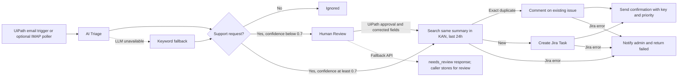

# FlowDesk — Intelligent Email-to-Ticket

Support email → validated AI triage → Jira Task → confirmation email. Spam is ignored; support requests with confidence below **0.7** wait for human review. A portable Maestro BPMN model and an independent Python 3.11/FastAPI service implement the process. The original FlowDesk 3.0 React SPA remains available.

## Architecture



`content/new.bpmn` includes task descriptions, conditional branches, an interrupting Jira error boundary, and complete BPMN DI. Studio Web must bind tenant connections, task implementations, variables, and end outputs before publishing. See [UiPath setup](docs/UIPATH_SETUP.md). The Python service runs immediately without UiPath.

## Quick start (Python 3.11)

From this repository's root:

```sh
make install
cp .env.example .env
make demo
```

All example values are empty. **DRY_RUN defaults to true**: no LLM, Jira, or SMTP requests are sent. Rule-based triage returns simulated keys such as `DRY-8F31D207`. Dry-run ticket URLs are empty because no real issue exists. Set `DRY_RUN=false` explicitly to enable configured integrations, and restart the service after configuration changes.

Equivalent commands without Make:

```sh
python3.11 -m venv .venv
. .venv/bin/activate
python -m pip install -r automation/requirements-dev.txt
uvicorn automation.main:app --host 127.0.0.1 --port 8000
```

Open `http://127.0.0.1:8000/docs` for the API schema or `GET /health` for service status. `make run` respects `.env`; `make demo` forces dry run. Network access is needed for initial dependency installation; tests themselves run offline.

## Process an email

In another terminal:

```sh
curl --fail-with-body -sS http://127.0.0.1:8000/process-email \
  -H 'Content-Type: application/json' \
  --data-binary @samples/access.json
```

Example dry-run response (generated identifiers vary):

```json
{
  "isTicket": true,
  "ticketKey": "DRY-8F31D207",
  "ticketUrl": "",
  "status": "created",
  "triage": {
    "is_ticket": true,
    "category": "Access",
    "priority": "High",
    "summary": "Login problem",
    "description": "I can't log in since this morning",
    "confidence": 0.93
  },
  "duplicate": false,
  "dryRun": true,
  "confirmation": "logged",
  "requestId": "generated-request-id",
  "error": null
}
```

Required input: `emailSubject`, `emailBody`, `senderEmail`. Optional: `receivedAt` (string). Sender addresses and input sizes are validated. The service accepts plain text or HTML bodies and strips HTML markup; attachments are outside this demo's scope.

| Response | HTTP | Meaning |
| --- | --- | --- |
| `ignored` | 200 | Newsletter, spam, or automatic reply; no Jira or SMTP call |
| `needs_review` | 200 | Support request, confidence < 0.7; no Jira or SMTP call |
| `created` | 200 | Issue created, or duplicate commented; inspect `duplicate` |
| `failed` | 502 | Jira configuration, transport, API, or response error; safe error code/message included |
| Validation error | 422 | Invalid input; nothing processed |
| Authentication error | 401 | Missing/incorrect Bearer token when API_AUTH_TOKEN is set |

`confirmation` is `sent`, `logged`, `failed`, or `not_requested`. If SMTP is configured but fails **after** Jira succeeds, status stays `created`, the key is retained, and `error.code` is `confirmation_failed`. Retry confirmation manually; do not recreate the issue. Admin notification failures are logged without masking the original result.

## Configuration

Environment variables override `.env`. Empty values use defaults. All supported variables are present in [.env.example](.env.example); never commit `.env`.

| Variable | Default / purpose |
| --- | --- |
| `DRY_RUN` | `true`; suppresses LLM/Jira/SMTP calls and disables mailbox polling |
| `API_AUTH_TOKEN` | Empty; optional Bearer authentication on POST /process-email |
| `LLM_API_KEY` | Empty; missing key uses keyword rules |
| `LLM_MODEL` | `gpt-4o-mini`; model name for the configured provider |
| `LLM_BASE_URL` | `https://api.openai.com/v1`; any compatible chat-completions endpoint, including its `/v1` prefix when needed |
| `JIRA_BASE_URL` | `https://maker200222.atlassian.net` |
| `JIRA_EMAIL`, `JIRA_API_TOKEN` | Empty; Atlassian email/API token for Basic auth |
| `JIRA_MAX_RETRIES` | `3`; additional retries on HTTP 429 or 5xx |
| `JIRA_BACKOFF_SECONDS` | `0.5`; exponential base delay plus jitter, respects Retry-After up to 60 seconds |
| `HTTP_TIMEOUT_SECONDS` | `20`; timeout for each external HTTP/SMTP/IMAP operation |
| `SMTP_HOST`, `SMTP_USER`, `SMTP_PASS` | Empty; missing host logs confirmation instead of sending |
| `SMTP_PORT` | `587` |
| `SMTP_FROM` | Empty; falls back to SMTP_USER, then flowdesk@localhost for logging |
| `SMTP_STARTTLS` | `true`; verified TLS upgrade |
| `SMTP_SSL` | `false`; set true with port 465 and SMTP_STARTTLS=false for implicit TLS |
| `ADMIN_EMAIL` | Empty; configured address receives failure notifications; otherwise admin events are logged |
| `IMAP_HOST`, `IMAP_USER`, `IMAP_PASS` | Empty; optional mailbox credentials (provider may require an app password) |
| `IMAP_PORT`, `IMAP_FOLDER` | `993`, `INBOX`; verified IMAPS |
| `POLL_INTERVAL_SECONDS` | `60` |
| `PROCESS_EMAIL_URL` | `http://127.0.0.1:8000/process-email` |
| `POLLER_STATE_PATH` | `automation/poller-state.db`; durable poller ledger/review inbox, ignored by Git |
| `LOG_LEVEL` | `INFO`; structured JSON event logs with secret redaction |
| `API_KEY`, `APP_ENV`, `DATABASE_URL` | Legacy variables preserved; unused by this service |

For live operation, set `DRY_RUN=false`, Jira email/token, and optionally SMTP/LLM credentials. With live mode and no Jira credentials, genuine high-confidence requests return a clear `failed` response; they are never silently simulated. The LLM adapter uses JSON-object mode and validates every field, type, enum, length, and confidence bound. Provider failures, malformed JSON, or incompatible output use the offline classifier. Providers with a different native API need a compatible gateway or an adapter.

Project `KAN` and issue type `Task` are fixed by the requested contract. Priority mapping is Critical → Highest, High → High, Medium → Medium, Low → Low. Jira priorities must exist in the project's priority scheme. Descriptions and comments use Atlassian Document Format and include `Reported by: <senderEmail>`. Labels match category except **Feature Request → Feature-Request**, since Jira labels cannot contain spaces.

Before creating, the service uses the [Jira enhanced JQL search API](https://developer.atlassian.com/cloud/jira/platform/rest/v3/api-group-issue-search/) to find candidate summaries from the last 24 hours, follows pagination, and compares normalized full summaries. An exact match gets a comment and confirmation with the existing key. **KAN-1, KAN-2, and KAN-3 are excluded and protected by a second code guard.**

## Tests and validation

```sh
make test
make validate
# Or, with the virtual environment active:
pytest
```

Tests mock external HTTP and SMTP, block accidental real HTTP traffic, and cover routing, strict LLM output/fallback, the 0.7 threshold, Jira payloads/auth, duplicate pagination, protected issues, retries/failures, SMTP failure preservation, poller acknowledgements/reviews, redaction, and BPMN/manifest integrity. `make validate` checks well-formed XML, JSON, preserved identity, graph references/reachability, and diagram coverage; UiPath runtime validation happens after tenant bindings are configured.

Build verification in the coding sandbox: Python 3.11 tests and in-process sample requests passed. Uvicorn reached application startup, but this environment denied both TCP and Unix socket binding (`Operation not permitted`), so a live curl request could not be verified here. Run the curl above in your normal terminal after `make demo`.

## Optional mailbox poller and review inbox

Start the API, configure IMAP plus `DRY_RUN=false`, then run:

```sh
make poller
make reviews
```

The poller fetches UNSEEN messages using BODY.PEEK every 60 seconds. It records successful outcomes before marking messages seen. Low-confidence email payloads are saved in the local SQLite review inbox first. `make reviews` explicitly displays those review records to the operator; normal logs omit message bodies and recipient addresses. Failed API processing leaves mail unseen. UID plus UIDVALIDITY/mailbox identity prevents replay after a seen-flag failure. Auto-Submitted messages are ignored to avoid reply loops.

Direct API callers must persist `needs_review` results and their input themselves. The fallback has no approval endpoint: a reviewer resolves these manually in Jira or through UiPath's approval task. Resending unchanged vague text will still return `needs_review`. Treat the review DB as customer data, keep it private, and apply your retention policy.

## Demo

1. Run `make demo`; show `/health` with `dryRun=true`.
2. POST `samples/access.json`: Access / High / created with a simulated key; confirmation appears in JSON logs.
3. POST `samples/feature.json`: Feature Request / Low / created.
4. POST `samples/newsletter.json`: ignored; POST `samples/review.json`: needs_review without a ticket.
5. Run `make test` to demonstrate mocked duplicate/comment and Jira failure paths without modifying Jira.
6. For a live demo, configure credentials and run `make run`. Submit a new, identifiable support request, then repeat the same summary: the second result references the first ticket with `duplicate=true`. The protected original issues remain untouched.
7. Import the BPMN in Studio Web, bind the connections, Debug, and publish using [docs/UIPATH_SETUP.md](docs/UIPATH_SETUP.md).

| Sample body | Offline category / priority | Expected status |
| --- | --- | --- |
| Weekly newsletter / unsubscribe | General / Low | ignored |
| I can't log in since this morning | Access / High | created |
| Please add dark mode | Feature Request / Low | created |
| Something seems odd. Can you help? | General / Medium | needs_review |
| We have a security breach | Bug / Critical | created |

## Assumptions and limits

- Inspection found a React SPA, with no entry-points.json or content/new.bpmn. Those artifacts were created from the supplied manifest while preserving `$schema`, `$id`, `uniqueId`, `type`, `filePath`, and `manualTrigger1`. Existing source files and database were retained.
- The provided `.bpmn` entry point is a Maestro **BPMN** process. The newer Maestro **Flow** modeler uses a separate node-based format; the setup guide covers both. This repository is not a tenant-bound UiPath solution package until imported and configured.
- Dry-run mode intentionally uses the offline classifier. Rule confidence values are heuristics, not calibrated probabilities. Newsletter keywords take precedence, so mixed newsletter/support content may need manual handling. Unsupported Critical classifications from the LLM are routed to review.
- Duplicate matching normalizes whitespace/case across senders, as requested. It is a best-effort Jira search, not an atomic idempotency guarantee: concurrent workers, search-index delay, and ambiguous/retried writes can still duplicate issues/comments. Transport failures are not blindly replayed; HTTP 429/5xx are retried with bounded backoff. Inspect Jira after an ambiguous failure. Use a durable message-ID queue/lock before scaling to multiple workers.
- Default hosting is loopback. Before exposing the service, configure API_AUTH_TOKEN, verified HTTPS and appropriate access controls. UiPath cloud cannot reach your Mac's localhost. Put credentials in `.env` or managed secrets; logging never emits raw mail, HTTP bodies/headers, or exception details. The explicit review-inspection command displays stored customer data.
- Tests and the dry-run demo do not contact live Jira, SMTP, LLM, or UiPath. Sign-in, import, runtime wiring, Debug and publish remain tenant-side steps.

## Existing React SPA

The original intelligence command center remains in `src/`: Intelligence Overview KPIs/charts, searchable Ticket Management, Research Analytics, Automation Lab, CSV export, and persistent browser storage. It uses React 18, TypeScript, Vite, and the existing custom CSS design system. Its browser demo state is independent of the new Jira service.

```sh
npm install
npm run dev
# Optional frontend typecheck/build:
npm run build
```

The older [uipath/STUDIO_WORKFLOW.md](uipath/STUDIO_WORKFLOW.md) describes a previous `/api/tickets` integration; use [the current guide](docs/UIPATH_SETUP.md) for `/process-email`. Existing research context is preserved in [RESEARCH_AND_ROADMAP.md](RESEARCH_AND_ROADMAP.md).
